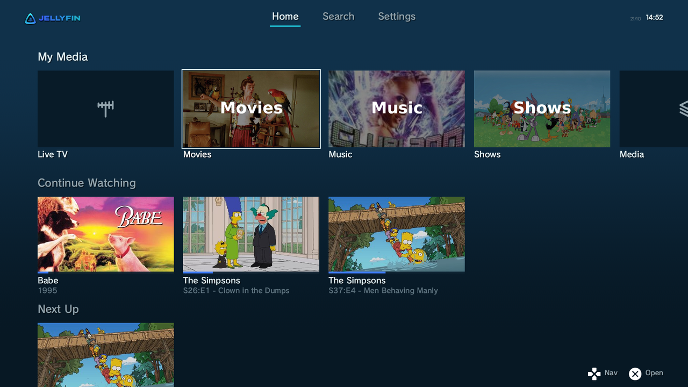
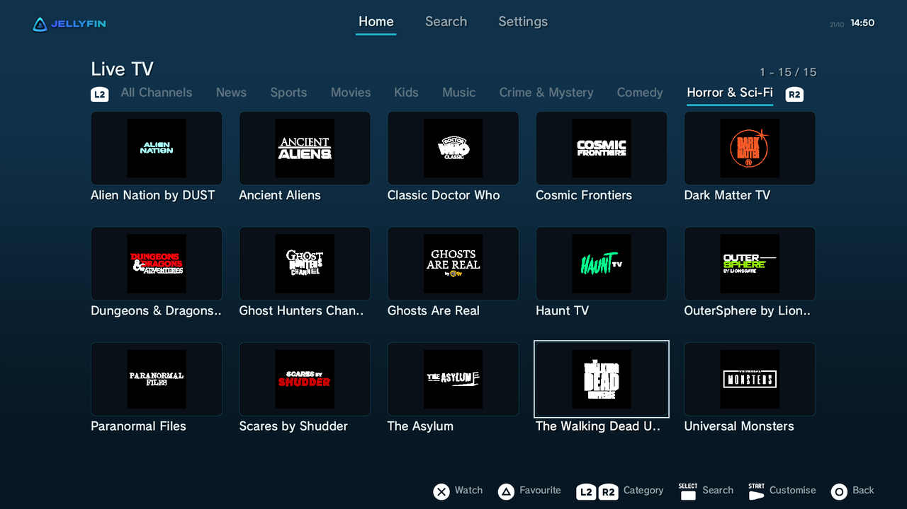
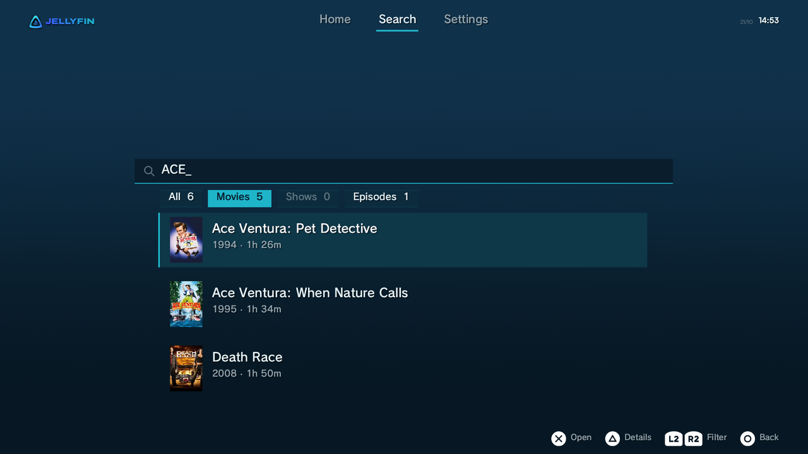
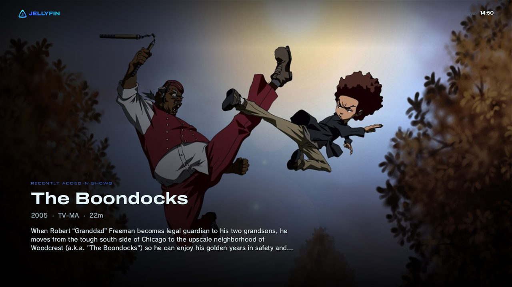
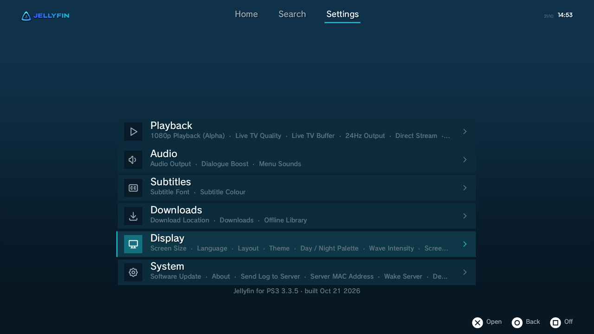
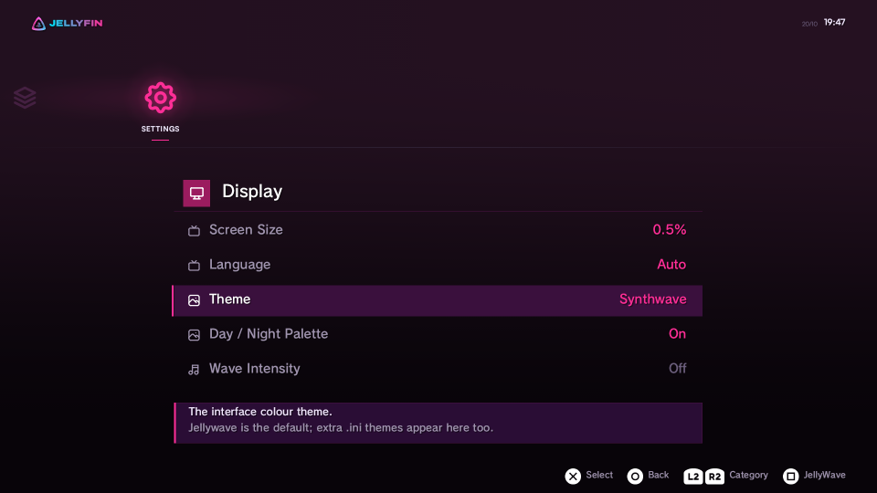

  

  A Jellyfin client for the PlayStation 3.

  [Download](https://github.com/jw-notes/JellyFin-PS3/releases/latest) · [What's changed](CUSTOM-CHANGES.md) · [Full manual](docs/MANUAL.md)

  

Watch your Jellyfin films, shows, music and Live TV on a PS3. Browse in the
**Classic** layout, laid out like Jellyfin in a web browser, or in an **XMB**
layout that looks and feels like the console's own menu.

This is my continuation of
[vortigauntlet's LosslessAudio fork](https://github.com/vortigauntlet/JellyFin-PS3-LosslessAudio),
which itself started from [MontyMcK's JellyFin-PS3](https://github.com/MontyMcK/JellyFin-PS3).
All of their work is still here, I just fixed and added things on top.

## Features

- Lossless TrueHD, Atmos and DTS-HD MA in 5.1 or 7.1, plus 1080p and 24 Hz output for films
- Two layouts: Classic (rows of posters under a header) or XMB (the PS3's own style)
- Live TV with a channel grid, genre tabs and remote-style controls
- Search as you type, with recent searches and Movies / Shows / Episodes filters
- A full-screen artwork screensaver that shows what each title is about
- Nine themes; each one recolours the whole app, the wave and the logo included
- Sign in with a Quick Connect code from your phone or computer, no typing needed
- Music player with visualisers, offline downloads, and files from USB drives

## A quick look

### Live TV

Every channel as a card, with genre tabs worked out from the channel names
(News, Sports, Movies, Kids, Crime & Mystery and more). While watching, the
D-pad works like a TV remote: left and right change channel, up and down the volume.

  

### Search

Results appear as you type, and L2 / R2 narrow them to Movies, Shows or Episodes.

  

### Artwork screensaver

After a few idle minutes the screen fills with backdrops from your library,
with what each one is about.

  

### Settings and themes

Everything is grouped into a few short pages. Each theme recolours the whole app;
this is Synthwave in the XMB layout.

  

  

## Install

You need a PS3 on CFW or HEN and a Jellyfin server on your network.

1. Download **JellyFin-PS3.pkg** from the [latest release](https://github.com/jw-notes/JellyFin-PS3/releases/latest).
2. Copy it to a USB stick, or to `/dev_hdd0/packages/` over FTP.
3. Install it from Package Manager. It shows up under **TV / Video Services**.

Installing over an older version keeps your sign-in and settings.

For the best picture and sound, turn on **Settings → Playback → 1080p Playback**,
set **Settings → Audio → Audio Output** to 5.1, and pick **Max** under Quality on a
film's page. If something stutters, drop Quality to **Very High**.
Live TV has its own settings under **Settings → Live TV**; on Wi-Fi, 480p and a
15-second buffer are the smoothest.
The [manual](docs/MANUAL.md) explains every setting and button.

## Building

It builds with the ps3dev SDK, inside Docker. Use the **nightly-2026-07-26** SDK
(GCC 7.2): newer ones use GCC 13, and their builds freeze on real hardware.
The steps are at the end of [CUSTOM-CHANGES.md](CUSTOM-CHANGES.md#building).

## Credits

- **vortigauntlet**: lossless audio, the XMB interface, JellyWave and most of the app
- **MontyMcK**: the original JellyFin-PS3
- **Ethan Hammer**, **Lucian** and **orbisai0security** for their contributions
- [Movian](https://github.com/andoma/showtime), FFmpeg, liba52, libdca, minimp3, stb,
  [PSL1GHT](https://github.com/ps3dev/PSL1GHT), mohasi's NTFS/exFAT drivers, and Jellyfin

Every library, font and icon set, with its licence, is listed in [CREDITS.md](CREDITS.md).

## License

GPLv3, see [LICENSE](LICENSE). Copyright (C) 2026 vortigauntlet and MontyMcK;
changes since 3.2.3 copyright (C) 2026 jw-notes.
